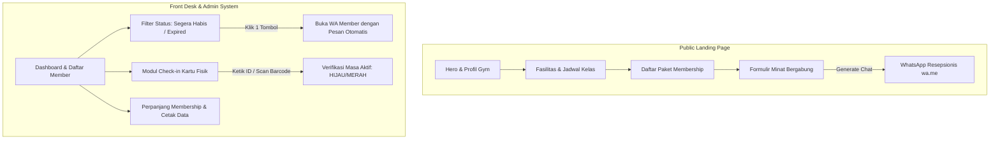
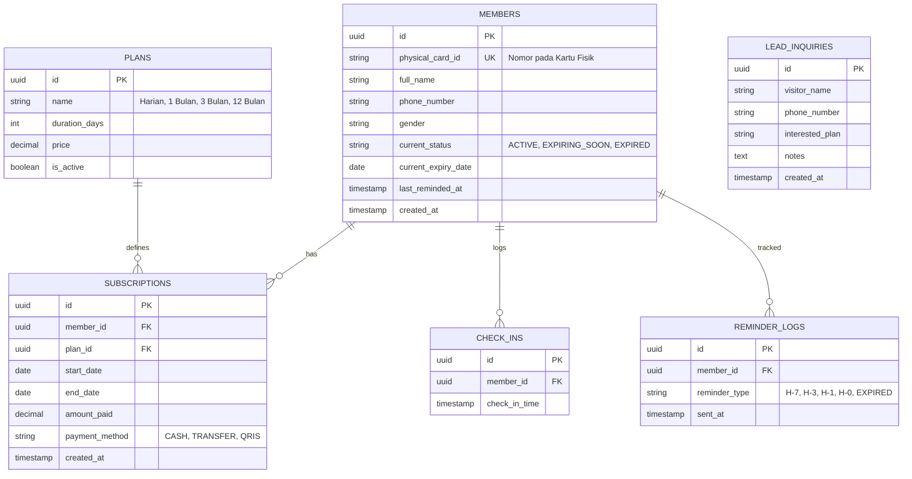

# Product Requirements Document (PRD) v1.2
## Gymqoo Fitness Center — Management System & Profile Landing Page
**Lokasi:** Jl. Mawar No.10, RT.001, Petung, Penajam, Penajam Paser Utara, Kaltim  
**Jam Operasional:** Senin – Minggu (08.30 – 21.00 WITA)  
**WhatsApp Admin:** 0853-9344-4424  
**Instagram:** @gym_qoo (Rating 4.5/5)

---

## 1. Executive Summary & Product Vision

### 1.1 Latar Belakang & Pendekatan Operasional
Aplikasi dirancang spesifik untuk kemudahan operasional pusat kebugaran (gym) dengan pendekatan **biaya operasional nol (Rp 0 setup fee)**, tanpa ketergantungan API pihak ketiga berbayar:
- **WhatsApp Click-to-Chat (`wa.me`):** Staf/resepsionis cukup menekan tombol "Kirim Pengingat WA" di dashboard untuk membuka chat WhatsApp dengan pesan pengingat personal yang sudah terisi otomatis (*pre-filled dynamic template*).
- **Kartu Member Fisik (Offline):** Sistem mendukung identifikasi member menggunakan kode Member ID atau scan barcode dari kartu fisik yang sudah dimiliki gym.
- **Lead Pendaftaran Minat Cepat:** Calon member dari landing page dapat memilih paket dan formulir langsung mengarahkan percakapan ke WhatsApp admin/resepsionis sekaligus mencatat prospek di database.

### 1.2 Tujuan Produk
1. **Public Landing Page (Gym Profile & Lead Gen):** Menampilkan profil gym, fasilitas, kelas, instruktur, daftar paket, jam operasional, peta lokasi, serta form minat pendaftaran langsung ke WhatsApp resepsionis.
2. **Back-Office Management & Reminder Hub:** Dashboard manajemen data member, pelacakan masa aktif (H-7 s/d Expired), tombol pengingat satu-klik ke WhatsApp member, dan pencatatan check-in harian kartu fisik.

---

## 2. Target Pengguna & Persona

| Persona | Peran | Alur Kerja Utama |
| :--- | :--- | :--- |
| **Calon Member** | Pengunjung Landing Page | Mengecek fasilitas, harga paket, dan menghubungi resepsionis via tombol pendaftaran minat WhatsApp. |
| **Resepsionis / Front Desk** | Operasional harian gym | Input member baru, mencari data saat member datang membawa kartu fisik, dan mengirimkan pesan tagihan/pengingat melalui tombol `wa.me`. |
| **Owner / Pengelola Gym** | Pemilik bisnis | Melihat statistik member aktif vs kadaluarsa dan memastikan follow-up perpanjangan berjalan setiap hari. |

---

## 3. Arsitektur Informasi & Alur Sistem



---

## 4. Rincian Fitur & Kebutuhan Fungsional

### Modul A: Public Landing Page (Gym Profile)
1. **Hero Section:**
   - Visual berenergi tinggi (dark mode modern dengan aksen neon emas/hijau/merah sporty).
   - Headline promosi & tombol aksi utama: *"Mulai Latihan Hari Ini"* & *"Konsultasi via WhatsApp"*.
2. **Profil & Fasilitas Gym:**
   - Galeri foto: Area beban bebas (*Free Weights*), mesin cardio, studio kelas ber-AC, locker, shower, dan area parkir.
   - Poin keunggulan gym: Lingkungan bersih, alat lengkap, trainer bersertifikasi.
3. **Program Latihan & Kelas:**
   - Daftar kelas harian/mingguan (e.g. HIIT, Bodybuilding, Calisthenics, Aerobik).
4. **Tabel Paket Membership:**
   - Opsi paket murni tanpa bonus gimmick:
     - Daily Pass (Harian): Rp 35.000
     - Member 1 Bulan: Rp 295.000
     - Member 3 Bulan: Rp 800.000 (Paling Diminati)
     - Member 6 Bulan: Rp 1.500.000
     - Member 12 Bulan: *Menyusul (Segera Hadir)*
   - Rincian benefit setiap paket (akses seluruh alat, ruang full AC & kipas sirkulasi, restroom, parkir).
5. **Formulir Pendaftaran Minat (Direct to WhatsApp):**
   - Kolom: Nama Lengkap, Nomor WhatsApp, Pilihan Paket, Catatan/Pertanyaan.
   - Tombol **"Kirim ke WhatsApp Resepsionis"**: Membuka tautan:
     `https://wa.me/{NO_HP_GYM}?text=Halo%20Admin,%20saya%20{Nama}%20tertarik%20mendaftar%20paket%20{Paket}.%20Bisa%20dibantu?`
6. **Lokasi & Jam Operasional:**
   - Embed Google Maps interaktif.
   - Jam buka: Senin - Jumat (06.00 - 22.00), Sabtu - Minggu (07.00 - 20.00).
   - Kontak resmi: Tombol telepon & media sosial (Instagram/TikTok).

---

### Modul B: Manajemen Member & Kartu Fisik (Back-Office)

1. **Input Data Member Baru:**
   - Nomor Kartu / Member ID (dapat disesuaikan dengan kode kartu fisik gym, misal: `MBR-00105`).
   - Nama lengkap, nomor WhatsApp aktif, tanggal lahir, jenis kelamin, alamat/catatan.
   - Pilihan paket keanggotaan & tanggal mulai (*start date*).
   - Tanggal kadaluarsa (*expiry date*) dihitung otomatis oleh sistem sesuai durasi paket.
2. **Kategori Status Masa Aktif:**
   - 🟢 **Aktif:** Masa aktif > 7 hari.
   - 🟡 **Segera Habis (Expiring Soon):** Tersisa 1 s/d 7 hari.
   - 🔴 **Habis Hari Ini (Expires Today):** Jatuh tempo hari ini.
   - ⬛ **Sudah Kadaluarsa (Expired):** Melewati tanggal jatuh tempo dan belum diperpanjang.
3. **Fitur Check-in Resepsionis (Pemeriksaan Kartu Fisik):**
   - Kotak pencarian cepat di meja resepsionis: Staf mengetik Member ID atau scan barcode dari kartu fisik member.
   - **Tampilan Hasil Seketika:**
     - Jika Aktif: Layar hijau menyala, menampilkan nama member, paket, dan sisa hari.
     - Jika Kadaluarsa: Layar merah peringatan: *"Membership telah habis sejak [Tanggal]. Harap lakukan perpanjangan."*
   - Pencatatan log jam kedatangan (Check-in time) otomatis tersimpan.
4. **Perpanjangan Membership (Renewal):**
   - Tombol **"Perpanjang"** pada profil member: Memilih durasi paket baru (misal +1 bulan atau +3 bulan), otomatis menambahkan tanggal masa aktif baru bersambung dari masa aktif sebelumnya.

---

### Modul C: Hub Peringatan Tagihan WhatsApp (`wa.me` Click-to-Chat)

Fitur ini menjawab kebutuhan notifikasi tanpa memerlukan biaya sewa server WhatsApp Gateway:

1. **Tab Khusus di Dashboard: "Perlu Diingatkan" (*Attention Required*):**
   - Menampilkan daftar member yang berada pada status:
     - H-7 (Tinggal 7 hari lagi)
     - H-3 (Tinggal 3 hari lagi)
     - H-1 (Besok berakhir)
     - Hari H (Hari ini berakhir)
     - Telah Kadaluarsa (1-7 hari lalu)
2. **Tombol "Ingatkan via WhatsApp" (One-Click WA Reminder):**
   - Setiap baris member memiliki tombol WhatsApp berwarna hijau dengan ikon chat.
   - Ketika diklik, langsung membuka WhatsApp (WhatsApp Web pada PC atau aplikasi WhatsApp di ponsel staf) dengan pesan yang sudah terisi otomatis sesuai kondisi member.
3. **Template Pesan Otomatis (URL-Encoded):**
   
   **Contoh Template H-3 (Segera Habis):**
   ```text
   Halo Kak {Nama_Member}! 💪
   
   Mengingatkan dari {Nama_Gym}, masa aktif membership Kakak ({Paket}) akan berakhir pada {Tanggal_Expired} ({Sisa_Hari} hari lagi).
   
   Yuk perpanjang sekarang di meja resepsionis agar latihan Kakak tetap nyaman dan tidak terputus. Terima kasih & salam sehat! 🔥
   ```

   **Contoh Template Hari H (Habis Hari Ini):**
   ```text
   Halo Kak {Nama_Member}, hari ini ({Tanggal_Expired}) adalah hari terakhir masa aktif membership Kakak di {Nama_Gym}.
   
   Jangan lupa perpanjang membership Kakak saat berkunjung hari ini ya. Sampai jumpa di gym! 🏋️‍♂️
   ```

   **Contoh Template Pasca-Expired (Follow-up):**
   ```text
   Halo Kak {Nama_Member}! Membership Kakak di {Nama_Gym} telah berakhir pada {Tanggal_Expired}.
   
   Kami siap menyambut kehadiran Kakak kembali untuk melanjutkan program kebugaran. Hubungi kami untuk perpanjangan ya Kak! 🙏
   ```

4. **Tanda Status Pengingat:**
   - Setelah staf mengklik tombol, sistem menandai *"Terakhir Diingatkan: [Tanggal & Jam]"* agar tidak terjadi pengiriman pengingat ganda oleh staf yang berbeda.

---

## 5. Skema Basis Data (Database Design)



---

## 6. Rekomendasi Tech Stack

- **Framework Web & API:** **Next.js 14+ (App Router)** — mendukung SSR cepat untuk Landing Page dan Dashboard admin interaktif dalam satu proyek.
- **Styling & Komponen:** **Tailwind CSS + shadcn/ui** — desain modern dark-mode bertema gym dengan komponen tabel, modal, dan badge yang bersih.
- **Database & ORM:** **PostgreSQL (Supabase / Neon / SQLite lokal)** dengan **Prisma ORM** — skema terstruktur dan query tanggal yang cepat.
- **Pesan WhatsApp:** **Standard URL wa.me protocol** (`https://wa.me/{phone}?text={encodedText}`) — 100% gratis, aman tanpa risiko pemblokiran nomor.
- **Autentikasi Staf:** Session-based / NextAuth.js sederhana untuk login resepsionis dan owner.

---

## 7. Rencana Eksekusi (Implementation Steps)

1. **Inisialisasi Project:** Next.js + Tailwind CSS + shadcn/ui + Prisma.
2. **Pembuatan Landing Page Publik:** Desain hero gym, fasilitas, program, harga paket, dan tombol pendaftaran minat ke WhatsApp.
3. **Pembuatan Dashboard Back-Office:**
   - Tabel data member dengan filter status (Aktif, Segera Habis, Expired).
   - Form pendaftaran & perpanjangan member dengan input nomor kartu fisik.
   - Kolom aksi tombol cepat WhatsApp Click-to-Chat.
4. **Modul Check-in Resepsionis:** Pencarian kartu fisik cepat dengan indikator visual hijau/merah.
